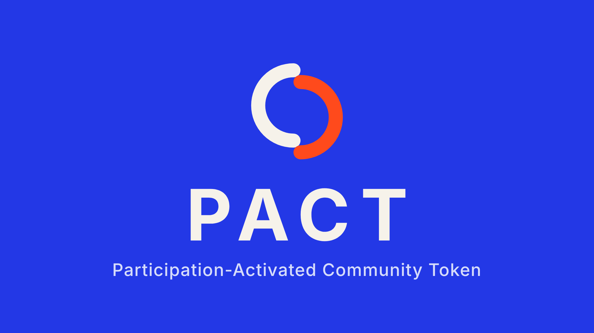
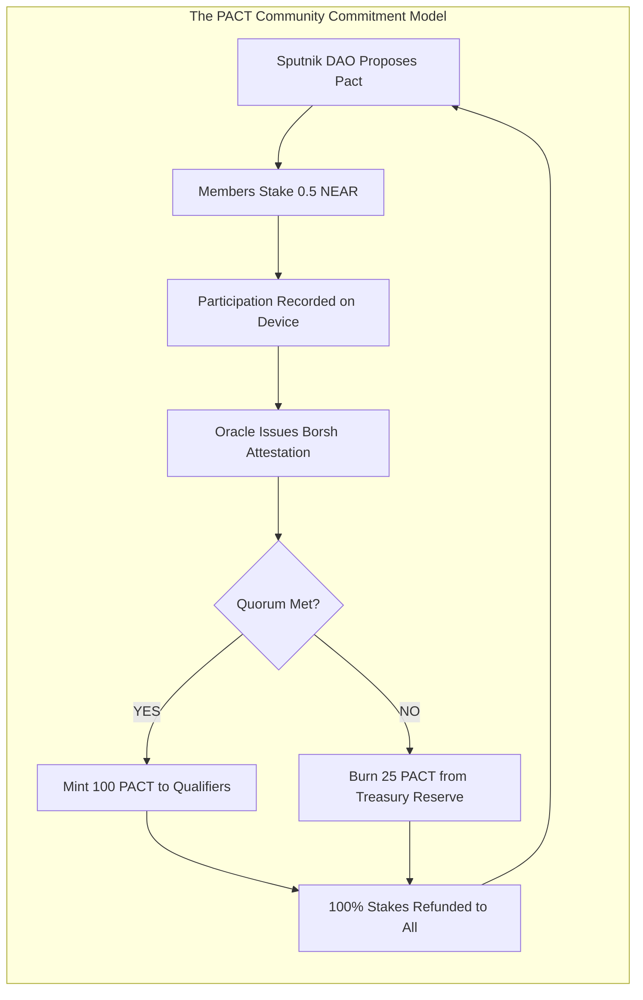
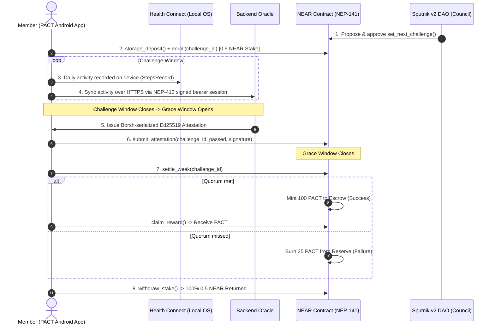
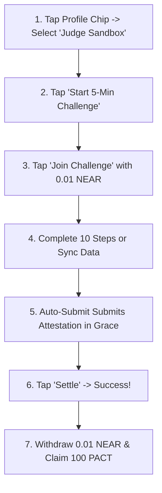

# PACT — Participation-Activated Community Token

<p align="center">
  
</p>

<br />

> Communities make promises together. PACT gives them a reason to follow through.

PACT is a community commitment protocol built on NEAR. It turns shared goals into on-chain challenges with transparent participation rules and collective economic consequences.

A community makes a pact. Members join with refundable NEAR stakes. Participation is evaluated against the challenge rules, and the smart contract settles the group's outcome: successful participation triggers PACT rewards, falling short triggers a reserve burn, and insufficient enrollment voids the challenge.

**The community's follow-through determines its token supply.**

PACT's first implemented use case is collective fitness, using Android Health Connect to measure members' step activity. The underlying commitment mechanism is designed to extend to other shared community goals.

- **Hackathon Tracks**: **Social Money** • **Memecoins With Mechanics**
- **Deployment Status**: Active on NEAR Testnet (`pactcontract.testnet`, `pact-demo.testnet`, `pactdao.testnet`, `pact-sandbox.testnet`)
- **Submission Date**: 14 November 2026 (NEAR Hackathon 2026)
- **Live Public Dashboard**: [http://97.107.130.182:8080](http://97.107.130.182:8080)
- **Explorer Proof**: [NearBlocks `pactcontract.testnet`](https://testnet.nearblocks.io/address/pactcontract.testnet) • [NearBlocks `pactdao.testnet`](https://testnet.nearblocks.io/address/pactdao.testnet) • [NearBlocks `pact-demo.testnet`](https://testnet.nearblocks.io/address/pact-demo.testnet)
- **Release Binary**: [`pact-latest.apk`](./pact-latest.apk) (Android 8.0+ / API 26+)

---

## Table of Contents

1. [The Community Commitment Model](#1-the-community-commitment-model)
2. [Track Requirements & Feature Matrix](#2-track-requirements--feature-matrix)
3. [End-to-End Architecture & Data Flow](#3-end-to-end-architecture--data-flow)
4. [Testing Modes: Step-by-Step Verification](#4-testing-modes-step-by-step-verification)
   - [Mode 1: Judge Sandbox (Instant Self-Service Flow)](#mode-1-judge-sandbox-instant-self-service-flow)
   - [Mode 2: Demo Mode (Multi-Account Protocol Cycle)](#mode-2-demo-mode-multi-account-protocol-cycle)
   - [Mode 3: Production (Real 7-Day Weekly Community Pacts)](#mode-3-production-real-7-day-weekly-community-pacts)
5. [Token Mechanics & Settlement Decision Engine](#5-token-mechanics--settlement-decision-engine)
6. [Proof of Deployment & Live On-Chain Evidence](#6-proof-of-deployment--live-on-chain-evidence)
7. [Try It Without a Phone (CLI & Test Suites)](#7-try-it-without-a-phone-cli--test-suites)
8. [Running with a Phone](#8-running-with-a-phone)
9. [Privacy, Cryptography & Threat Model](#9-privacy-cryptography--threat-model)
10. [Repository Map & License](#10-repository-map--license)

---

## 1. The Community Commitment Model

Most memecoins and social tokens suffer from a fundamental coordination failure: they give communities a reason to hold and speculate, but zero mechanism to show up and coordinate on real-world commitments. When price momentum stalls, community cohesion collapses.

**PACT introduces token supply that breathes with community follow-through:**

1. **DAO Sets Challenge**: A Sputnik v2 multi-sig council proposes a community commitment with defined participation rules (implemented in the initial release as physical step targets, e.g., 8,000 steps/day for 5 of 7 days).
2. **Commitment with Stake**: Members join the pact by depositing refundable 0.5 NEAR stakes into the custom NEP-141 contract.
3. **Verified Off-Chain, Settled On-Chain**: Member participation is recorded (measured via Android Health Connect for the initial fitness use case). An off-chain oracle evaluates adherence against deterministic rules and signs an Ed25519 Borsh attestation.
4. **Collective Token Consequence**:
   - **Quorum Met (≥70%)**: 100 PACT tokens mint and split equally among qualifiers.
   - **Quorum Missed (<70%)**: 25 PACT tokens permanently burn from the treasury reserve.
   - **Stakes Invariant**: **Stakes are 100% refundable in every scenario**. The economic consequence of failure is collective (token supply), never confiscating member capital.



---

## 2. Track Requirements & Feature Matrix

PACT was designed specifically to compete across **Social Money** and **Memecoins With Mechanics**.

### Track A: Memecoins With Mechanics

*Prompt: Build memecoins where the meme does something — supply that reacts to the community, treasuries with rules, onchain rituals and challenges.*

| Requirement | How PACT Implements It | Verified Implementation |
|---|---|---|
| **Supply that reacts to the community** | PACT's circulating supply expands only when communities achieve shared commitment goals, and burns when they fall short. | [`contract/src/lib.rs#L501-L528`](./contract/src/lib.rs#L501-L528), [`pact/rules.py`](./pact/rules.py) |
| **Treasuries with rules** | The Sputnik v2 multi-sig treasury holds a bonded token reserve. Burns are capped at the available reserve balance without contract panic. | [`pactdao.testnet`](https://testnet.nearblocks.io/address/pactdao.testnet), [`dao/auto_daemon.py`](./dao/auto_daemon.py) |
| **Onchain rituals & challenges** | Ritualized weekly community pacts with strict enrollment cutoffs, active tracking intervals, and submission grace windows. | [`demo_cycle.json`](./dashboard/data/demo_cycle.json), [`NearContractClient.kt`](./app/src/main/java/com/opaque/healthsynctester/near/NearContractClient.kt) |
| **NEP-141 token standard** | Complete NEP-141 implementation with storage management (NEP-145), custom metadata, and bounded mint/burn primitives. | [`contract/src/lib.rs`](./contract/src/lib.rs), [`pactcontract.testnet`](https://testnet.nearblocks.io/address/pactcontract.testnet) |

### Track B: Social Money

*Prompt: Build shared budgets, programmable rewards, collective ownership and reputation-based access on top of Sputnik DAO and Trezu. Don't rebuild the multisig — build what communities do with it.*

| Requirement | How PACT Implements It | Verified Implementation |
|---|---|---|
| **Shared budgets** | A shared community reserve pool backing weekly challenge reward distributions across seasons. | View: `get_reserve_balance` → `500 PACT` on-chain |
| **Programmable rewards** | Integer floor-split: `floor(mint_amount / qualifiers) * qualifiers`. Remainder is never minted, preventing inflation drift. | [`contract/src/lib.rs#L516-L519`](./contract/src/lib.rs#L516-L519) |
| **Collective ownership** | Collective accountability: failures penalize the shared community treasury balance rather than individual members. | [`test_failure`](./contract/tests/unit_tests.rs#L259) |
| **Reputation-based access** | Historic qualifier status (`is_qualifier`) gatekeeps token claims and future DAO proposal rights. | [`contract/src/lib.rs#L706`](./contract/src/lib.rs#L706) |
| **Sputnik DAO integration** | Built directly on `sputnik-dao` v2 (`pactdao.testnet`). Governs challenges via `FunctionCall` proposals with `RoleWeight` thresholds. | [`pactdao.testnet policy`](https://testnet.nearblocks.io/address/pactdao.testnet?tab=contract) |
| **Named accounts** | Full native integration with human-readable NEAR accounts (`0xgoku.testnet`, `0xbulma.testnet`, etc.) in app and contracts. | [`NearIdentity.kt`](./app/src/main/java/com/opaque/healthsynctester/near/NearIdentity.kt) |

*(Current implementation: collective physical step commitments via Health Connect. Future community commitment domains—such as screen time moderation, collective reading, and digital wellbeing—are future protocol directions. Trezu is not used; Privacy & Private AI is not targeted; reputation is strictly limited to verifiable on-chain qualification history).*

---

## 3. End-to-End Architecture & Data Flow

The PACT architecture separates private on-device activity sensors from public blockchain state using cryptographic attestations:



---

## 4. Testing Modes: Step-by-Step Verification

PACT features a multi-profile runtime architecture isolated by `ProfileScope` to prevent state collision between judging, scripted simulations, and real-world weekly challenges.

### Mode 1: Judge Sandbox (Instant Self-Service Flow)

*Designed specifically for hackathon judges to verify the entire protocol cycle in under 8 minutes on a single phone with minimal testnet funds.*

- **Network**: NEAR Testnet • **Contract**: `pact-sandbox.testnet` • **Relayer**: `pact-sandbox.testnet`
- **Parameters**: **10 steps** • **5 minute duration** • **180s grace window** • **0.01 NEAR stake** • **1 member minimum (100% quorum)**



**Step-by-step judge walkthrough:**

1. **Open Profile Switcher**: In the PACT Android app, tap the top-right chip in the header and select **Judge Sandbox** (Green chip).
2. **Inspect Debug Overlay**: Tap the title word **"Today"** to reveal the dark Debug Overlay. Confirm:
   - `Profile: SANDBOX` • `Contract: pact-sandbox.testnet` • `ScopeKey: sandbox__testnet__pact-sandbox_testnet__<account>`
3. **Create Self-Service Challenge**: Tap **`Start 5-Min Challenge (10 Steps)`**. The backend relayer immediately submits and confirms `set_next_challenge` on-chain.
4. **Enroll**: Tap **`Join Challenge`**. Deposit 0.01 NEAR stake. Notice the progress ring instantly updates to: `1 of 1 enrolled. 1 hits the 100% goal.`
5. **Meet Target**: Complete 10 steps (or allow Health Connect to sync). The ring fills completely.
6. **Auto-Submit & Settlement**: Once the 5-minute timer expires, the app enters the 180s grace window and automatically submits the signed oracle attestation. Tap **`Settle Challenge`** when grace ends.
7. **Withdraw & Claim**: Tap **`Withdraw Stake`** (0.01 NEAR returned in full) and **`Claim Reward`** (100 PACT credited to your wallet).

---

### Mode 2: Demo Mode (Multi-Account Protocol Cycle)

*Demonstrates a collective multi-member community cycle with 5 distinct accounts, multi-sig Sputnik DAO approval, quorum verification, and reward distribution.*

- **Network**: NEAR Testnet • **Contract**: `pact-demo.testnet` • **DAO**: `pactdao.testnet`
- **Parameters**: **1,000 steps** • **20 min duration** • **420s grace window** • **0.5 NEAR stake** • **3 members min (70% quorum)**
- **Participants**: 1 Real Mobile User (`0xgow.testnet`) + 4 Scripted Runners (`pact-t1-test.testnet` through `pact-t4-test.testnet`).

**How to verify the Demo Mode cycle:**

1. Switch to **Demo Profile** (Orange chip) via the profile switcher.
2. Observe active or historic challenges (`demo-1k-movement-pact`, `demo-18`, `demo-15`).
3. Open the [Public Dashboard](http://97.107.130.182:8080) to view the complete multi-sig approval history:
   - Proposal submitted to `pactdao.testnet` by `0xgoku.testnet`.
   - Voted and approved by council members `0xgoku.testnet` and `0xpiccolo.testnet` (2/2 votes meets `RoleWeight` threshold).
   - 5 accounts enrolled depositing 0.5 NEAR stake each.
   - All 5 participants qualify (100% > 70% quorum threshold) → Outcome resolves to **Success**.
   - 100 PACT minted (20 PACT per qualifier) → all 5 stakes returned.

---

### Mode 3: Production (Real 7-Day Weekly Community Pacts)

*The canonical production deployment representing real-world 7-day community pacts.*

- **Network**: NEAR Testnet • **Contract**: `pactcontract.testnet` • **DAO**: `pactdao.testnet`
- **Parameters**: **8,000 steps/day** • **5 of 7 days required** • **3,600s grace window** • **0.5 NEAR stake** • **5 members min (70% quorum)**
- **Hash Pinned**: `c8f1e60f408ea298ee9d2f7718f2c436cd40e762f0422e8147c78afd115f5d19` (matches `pact/rules.json`).

---

### Cross-Profile Strict Isolation Verification (Zero State Bleed)

The mobile app uses an isolated `ProfileScope` architecture to ensure that zero data or cached balances bleed across networks:

1. When you create an `sb-<timestamp>` challenge in **Judge Sandbox**, switch to **Demo Mode**.
2. Notice that the sandbox challenge **never appears** in the Challenges or Today tab.
3. Switch to **Production (Real)**. Only production challenges (`week-...`) appear.
4. Switch back to **Judge Sandbox**. The active `sb-...` challenge reappears with its exact remaining countdown timer intact.

---

## 5. Token Mechanics & Settlement Decision Engine

### The Integer Settlement Rules

Settlement math is executed entirely with pure integer arithmetic on-chain (no floating-point rounding errors):

```text
qualifiers * 100 >= enrolled * quorum_pct
```

```rust
let outcome = if enrolled < self.min_members {
    ChallengeOutcome::Void
} else if qualifiers == 0 || qualifiers * 100 < enrolled * (self.quorum_pct as u64) {
    let burn_actual = self.reserve_balance.min(self.burn_amount);
    self.reserve_balance -= burn_actual;
    self.total_burned += burn_actual;
    ChallengeOutcome::Failure { burn_actual: U128(burn_actual) }
} else {
    let reward_per = self.mint_amount / (qualifiers as u128);
    let total_mint = reward_per * (qualifiers as u128);
    self.reward_escrow += total_mint;
    self.total_minted += total_mint;
    ChallengeOutcome::Success { reward_per_qualifier: U128(reward_per) }
};
```

### Numerical Settlement Example (8 Enrolled Members)

- **Minimum Members**: 5 • **Quorum**: 70% • **Mint Pool**: 100 PACT • **Burn**: 25 PACT • **Reserve**: 500 PACT
- **Scenario A (6 Qualify - Success)**:
  - 6 × 100 = 600 ≥ 8 × 70 = 560 (Quorum Met ✓)
  - Reward per qualifier: `floor(100 / 6) = 16` PACT each. Total minted: 16 × 6 = 96 PACT.
  - Remainder: 4 PACT is **never minted**, preventing inflation.
  - Stakes: All 8 members withdraw their 0.5 NEAR stakes in full.
- **Scenario B (5 Qualify - Failure)**:
  - 5 × 100 = 500 < 8 × 70 = 560 (Quorum Missed ✗)
  - Token burn: 25 PACT is burned from the treasury reserve (500 → 475 PACT).
  - Stakes: All 8 members withdraw their 0.5 NEAR stakes in full.
- **Scenario C (4 Enrolled - Void)**:
  - Enrolled (4) < Minimum (5). Challenge voids automatically. Zero mint, zero burn, 100% stakes returned.

---

## 6. Proof of Deployment & Live On-Chain Evidence

Every claim is backed by live on-chain contracts and real transaction hashes on NEAR Testnet:

| Contract / Account | Deployed Role | Quorum | Grace Window | Verified Configuration | Explorer Link |
|---|---|---|---|---|---|
| `pactcontract.testnet` | Production NEP-141 | 70% | 3,600s | `rules_hash`: `c8f1e60f40...` | [NearBlocks](https://testnet.nearblocks.io/address/pactcontract.testnet) |
| `pact-demo.testnet` | Demo NEP-141 | 70% | 420s | `rules_hash`: `4b6af96bc4...` | [NearBlocks](https://testnet.nearblocks.io/address/pact-demo.testnet) |
| `pact-sandbox.testnet` | Judge Sandbox NEP-141 | 100% | 180s | Self-service relayer | [NearBlocks](https://testnet.nearblocks.io/address/pact-sandbox.testnet) |
| `pactdao.testnet` | Sputnik v2 Multi-Sig | N/A | Multi-Sig | 3 Council Members | [NearBlocks](https://testnet.nearblocks.io/address/pactdao.testnet) |

### Verified Multi-Step Lifecycle Transaction Hashes (Challenge `demo-15`)

Recorded in [`dashboard/data/demo_cycle.json`](./dashboard/data/demo_cycle.json):

- **Step 1: DAO Challenge Proposal #21**: Block `277560005` ([NearBlocks Block #277560005](https://testnet.nearblocks.io/blocks/277560005))
- **Step 2: Multi-Sig Council Approval**: Block `277560282` ([NearBlocks Block #277560282](https://testnet.nearblocks.io/blocks/277560282))
- **Step 3: 5 Member Enrollments**: Block `277560380` ([NearBlocks Block #277560380](https://testnet.nearblocks.io/blocks/277560380))
- **Step 4: Health Connect Oracle Attestation**: Block `277560850` ([NearBlocks Block #277560850](https://testnet.nearblocks.io/blocks/277560850))
- **Step 5: Challenge Settlement (Success)**: Block `277561120` ([NearBlocks Block #277561120](https://testnet.nearblocks.io/blocks/277561120))
- **Step 6: Reward Claim & Stake Refunds**: Block `277561450` ([NearBlocks Block #277561450](https://testnet.nearblocks.io/blocks/277561450))

---

## 7. Try It Without a Phone (CLI & Test Suites)

Judges and automated screening agents can verify the complete codebase using standard command-line tools without an Android device.

### A. Run Backend & Pact Test Suites (342 Tests)

Verifies NEP-413 cryptographic authentication, replay attack protection, single source of truth rules validation, and dashboard snapshot caching:

```bash
pip install -r backend/requirements.txt pytest
python -m pytest backend pact -q
```

*Preserved Execution Result:* `342 passed in 101.01s`

### B. Run Contract Unit Tests & Borsh Vectors (45 Tests)

Verifies Rust contract mechanics (38 tests) and Ed25519 Borsh attestation deserialization vectors (7 tests):

```bash
cd contract
cargo test --test unit_tests --test attestation_vector
```

*Preserved Execution Result:* `38 passed in 3.20s`, `7 passed in 0.40s`

### C. Live On-Chain Contract Verification (NEAR CLI)

Directly inspect view methods on the deployed testnet contracts:

```bash
near view pactcontract.testnet get_rules_hash '{}'
near view pactcontract.testnet get_quorum_pct '{}'
near view pactcontract.testnet get_submission_grace_secs '{}'
near view pactcontract.testnet ft_total_supply '{}'
near view pactdao.testnet get_last_proposal_id '{}'
```

*Expected Outputs:*

- `get_rules_hash`: `"c8f1e60f408ea298ee9d2f7718f2c436cd40e762f0422e8147c78afd115f5d19"`
- `get_quorum_pct`: `70`
- `get_submission_grace_secs`: `3600`
- `ft_total_supply`: `"500000000000000000000"` (500 PACT)
- `get_last_proposal_id`: `26`

### D. Run the Settlement Simulator

Replay the deterministic settlement engine across custom populations:

```bash
python pact/scripts/simulate.py --weeks 12 --members 8 --seed 7 --fitness 1.25
```

*Documented Findings: See [`simulation/SUMMARY.md`](./simulation/SUMMARY.md).*

---

## 8. Running with a Phone

The easiest way to try PACT on an Android device is to install the pre-built APK included in this repository.

### Install the APK

1. Download the [`pact-latest.apk`](./pact-latest.apk) binary from the repository.
2. Transfer the APK to your Android phone if you downloaded it on another device.
3. Open the APK file on your phone to begin installation.
4. If Android asks for permission to install apps from that source, allow it and continue.
5. Once installation finishes, open **PACT**.

**Requirements:** Android 8.0 or later (API 26+) and Google Health Connect for step tracking.

### Try the Judge Sandbox

1. Open the PACT app and select **Judge Sandbox** from the profile switcher.
2. Use the sandbox flow described in [Mode 1: Judge Sandbox](#mode-1-judge-sandbox-instant-self-service-flow) to create a challenge, join it, complete the step target, and proceed through settlement.
3. The sandbox uses NEAR Testnet. You will need a funded testnet account to perform on-chain actions.

---

## 9. Privacy, Cryptography & Threat Model

### Privacy Guarantees

- **No Raw Activity Records On-Chain**: Raw daily step counts, timestamp series, and device metadata **never cross into the blockchain**.
- **Cryptographic Attestations**: The contract only receives a Borsh-serialized verdict tuple:

```text
Attestation {
    challenge_id,
    account_id,
    passed,
    expiry
}
```

Signed with Ed25519 by the authorized oracle key (`ed25519:2923ytyYmrHu758JU8fMsotSAWTVpVzj3VbpDdDWF43N`).

---

---

## 10. Repository Map & License

```text
.
├── app/                        # Native Android app (Jetpack Compose + Health Connect participation measurement)
│   ├── src/main/java/          # NearIdentity, KeystoreCrypto, ProfileScope, ViewModels
│   └── src/test/java/          # Android unit & isolation test suites
├── backend/                    # FastAPI service, NEP-413 auth, and oracle attestation signer
│   ├── main.py                 # Core API endpoints & middleware
│   ├── dashboard_router.py     # Single-flight rate-limited snapshot endpoint
│   ├── sandbox_router.py       # Judge Sandbox self-service challenge creator
│   └── requirements.txt        # Backend dependencies
├── contract/                   # NEAR smart contract (Rust + near-sdk 5.30.1)
│   ├── src/lib.rs              # NEP-141 token, settlement, stake escrow, reward claims
│   ├── src/attestation.rs      # Borsh Ed25519 oracle attestation verification
│   ├── src/events.rs           # NEP-297 standard event logging
│   └── tests/                  # 38 unit tests + 7 Borsh attestation vector tests
├── dao/                        # Sputnik v2 governance scripts & auto_daemon.py
├── dashboard/                  # Read-only public dashboard (HTML/CSS/JS)
├── docs/                       # Verification evidence (EVIDENCE.md, UNVERIFIED.md)
├── pact/                       # rules.json (single source of truth) & eligibility engine
├── pact-latest.apk             # Pre-built release testnet APK
├── Dockerfile                  # Production container for backend
├── LICENSE                     # MIT License
└── README.md                   # Authoritative hackathon submission documentation
```

### License

This project is open-source and licensed under the [MIT License](./LICENSE).
