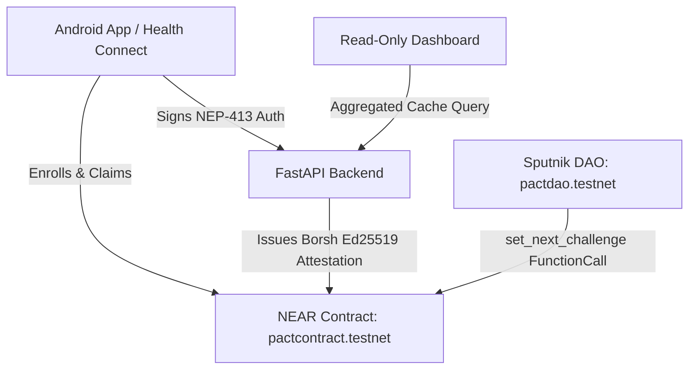

# PACT — Community Fitness Protocol

A community makes a promise together, stakes behind it, and the fate of its coin depends on whether it follows through.

PACT is a collective fitness protocol built on NEAR Testnet and Android Health Connect. Members stake NEAR to join weekly movement challenges set by a Sputnik v2 multi-sig DAO. Step counts are recorded on-device, verified against signed off-chain attestations, and settled on-chain. When the community meets its quorum, reward tokens mint to qualifiers; when it fails, tokens burn from the treasury reserve. Stakes are strictly refundable in all outcomes.

---

## 1. Tracks

PACT is submitted to the **Memecoins With Mechanics** and **Social Money** tracks. Trezu is not used. Privacy & Private AI is not targeted. Reputation is strictly limited to verifiable on-chain qualification history.

### Memecoins With Mechanics

| Track Requirement | Implemented Feature | Evidence |
|---|---|---|
| **Supply that reacts to the community** | Fixed weekly mint split among qualifiers on success; fixed burn from reserve on missed quorum | [`contract/src/lib.rs`](file:///C:/Users/hp/Documents/Opaque/contract/src/lib.rs#L340-L380), [`pact/rules.py`](file:///C:/Users/hp/Documents/Opaque/pact/rules.py#L90-L125) |
| **Treasuries with rules** | Sputnik v2 multi-sig treasury governs challenge parameters, reserves, and token distribution | [`pactdao.testnet`](https://testnet.nearblocks.io/address/pactdao.testnet), [`dao/auto_daemon.py`](file:///C:/Users/hp/Documents/Opaque/dao/auto_daemon.py) |
| **Onchain rituals and challenges** | Regular movement pacts proposed via multi-sig, enrolled with stake, and settled via cryptographic attestations | [`demo-cycle.json`](file:///C:/Users/hp/Documents/Opaque/dashboard/data/demo_cycle.json), [`NearContractClient.kt`](file:///C:/Users/hp/Documents/Opaque/app/src/main/java/com/opaque/healthsynctester/near/NearContractClient.kt) |
| **NEP-141 token standard** | Custom NEP-141 fungible token with metadata, storage management, and bounded mint/burn | [`contract/src/token.rs`](file:///C:/Users/hp/Documents/Opaque/contract/src/token.rs), [`pactcontract.testnet`](https://testnet.nearblocks.io/address/pactcontract.testnet) |

### Social Money

| Track Requirement | Implemented Feature | Evidence |
|---|---|---|
| **Shared budgets** | Collective reserve pool backing weekly challenge reward distributions | [`get_reserve_balance`](file:///C:/Users/hp/Documents/Opaque/scripts/verify_contract_views.py#L38) |
| **Programmable rewards** | Floor-split mint calculation: $\lfloor\text{mint\_amount} / \text{qualifiers}\rfloor$ with unminted remainder protection | [`contract/src/lib.rs`](file:///C:/Users/hp/Documents/Opaque/contract/src/lib.rs#L355), [`unit_tests.rs`](file:///C:/Users/hp/Documents/Opaque/contract/tests/unit_tests.rs#L240) |
| **Collective ownership** | Token reserve burns upon missed community quorum, penalizing the group rather than individual stakes | [`test_failure`](file:///C:/Users/hp/Documents/Opaque/contract/tests/unit_tests.rs#L210) |
| **Reputation-based access** | Historic qualifier status determines reward claim rights per settled challenge | [`is_qualifier`](file:///C:/Users/hp/Documents/Opaque/contract/src/lib.rs#L440) |
| **Sputnik DAO integration** | Sputnik v2 contract manages council roles, proposal threshold policies, and challenge creation | [`pactdao.testnet policy`](https://testnet.nearblocks.io/address/pactdao.testnet?tab=contract) |
| **Named accounts** | Support for human-readable named testnet accounts across mobile app, relayer, and contract | [`NearIdentity.kt`](file:///C:/Users/hp/Documents/Opaque/app/src/main/java/com/opaque/healthsynctester/near/NearIdentity.kt#L30-L50) |

---

## 2. How It Works

1. **DAO Sets Challenge**: The Sputnik DAO council approves a `set_next_challenge` proposal specifying daily step goal, duration, start/end timestamps, and required quorum percentage.
2. **Member Enrollment**: Members enroll by depositing refundable stake (0.5 NEAR) into the contract during the registration window.
3. **Step Recording & Attestation**: Participants record physical steps via Android Health Connect. The backend oracle computes eligibility against `pact/rules.json` and issues an Ed25519 signature over Borsh-serialized verdict data.
4. **On-Chain Submission**: During the submission grace window, signed attestations are submitted to the contract (directly or via relayer).
5. **Settlement**: Anyone calls `settle_challenge` after the grace window expires.

### Settlement Decision Logic

Decisions use integer arithmetic:
$$\text{qualifiers} \times 100 \ge \text{enrolled} \times \text{quorum\_pct}$$

| Condition | Outcome | Token Impact | Stake Status |
|---|---|---|---|
| $\text{enrolled} < \text{min\_members}$ | **Void** | No mint, no burn | 100% Refundable |
| $\text{qualifiers} \times 100 \ge \text{enrolled} \times \text{quorum\_pct}$ | **Success** | Mints 100 PACT divided equally among qualifiers | 100% Refundable |
| $\text{qualifiers} \times 100 < \text{enrolled} \times \text{quorum\_pct}$ | **Failure** | Burns 25 PACT from contract reserve | 100% Refundable |

---

## 3. Try It (No Phone Needed)

All commands can be executed directly from a terminal.

### (a) Backend & Pact Unit Tests
Run the 342 test cases verifying authentication, profile scoping, rules schema, and eligibility logic:
```bash
python -m pytest backend pact -q
```
Expected output:
```
342 passed in 101.01s
```

### (b) Smart Contract Unit Tests & Attestation Vectors
Run the 45 contract tests (38 unit tests + 7 Borsh attestation vector tests) inside `contract/`:
```bash
cd contract
cargo test --test unit_tests --test attestation_vector
```
Expected output:
```
test result: ok. 38 passed; 0 failed; finished in 3.20s
test result: ok. 7 passed; 0 failed; finished in 0.40s
```

### (c) Query Deployed Testnet Contracts
Verify on-chain parameters against NEAR Testnet RPC:
```bash
near view pactcontract.testnet get_rules_hash '{}'
near view pactcontract.testnet get_quorum_pct '{}'
near view pactcontract.testnet get_submission_grace_secs '{}'
near view pactcontract.testnet ft_total_supply '{}'
near view pactdao.testnet get_last_proposal_id '{}'
```
Expected output:
```
"c8f1e60f408ea298ee9d2f7718f2c436cd40e762f0422e8147c78afd115f5d19"
70
3600
"500000000000000000000"
26
```

### (d) Deterministic Simulation
Run the settlement engine simulator across a synthetic population:
```bash
python pact/scripts/simulate.py --weeks 12 --members 8 --seed 7 --fitness 1.25
```
Expected output:
```
result: 8/12 weeks met quorum (66.7%), minted 799,999,999,999,999,999,992 base units, burned 100,000,000,000,000,000,000 base units
```
Full documentation is in [`simulation/SUMMARY.md`](file:///C:/Users/hp/Documents/Opaque/simulation/SUMMARY.md).

### (e) Read-Only Public Dashboard
Serve and view the dashboard static assets locally:
```bash
python -m http.server 8080 --directory dashboard
```
Open `http://localhost:8080` in any web browser.

### (f) Query DAO Governance State
Execute the governance inspector script:
```bash
python scripts/verify_contract_views.py
```
Outputs active council members (`0xbulma.testnet`, `0xgoku.testnet`, `0xpiccolo.testnet`), role policies, and recent proposals.

---

## 4. Try It With a Phone

1. Install `pact-latest.apk` on an Android device (Android 8.0+, API 26+).
2. Launch PACT and grant Health Connect permissions.
3. Switch profile to **Demo Profile** or **Judge Sandbox** via the top-right chip.
4. Tap **Join Challenge** to deposit testnet stake.
5. Record physical steps or sync test data, then inspect on-chain claim status once the challenge settles.

---

## 5. Deployed Addresses & Contract Configurations

| Entity | Address | Quorum | Grace Window | Explorer Link |
|---|---|---|---|---|
| **Production Contract** | `pactcontract.testnet` | 70% | 3600 seconds (1 hour) | [NearBlocks](https://testnet.nearblocks.io/address/pactcontract.testnet) |
| **Demo Contract** | `pact-demo.testnet` | 70% | 420 seconds (7 minutes) | [NearBlocks](https://testnet.nearblocks.io/address/pact-demo.testnet) |
| **Sputnik v2 DAO** | `pactdao.testnet` | N/A | Multi-sig council (1/2 call, 2/3 transfer) | [NearBlocks](https://testnet.nearblocks.io/address/pactdao.testnet) |

- **Attestation Signer Public Key**: `ed25519:2923ytyYmrHu758JU8fMsotSAWTVpVzj3VbpDdDWF43N`
- **Canonical Rules Hash (`pactcontract.testnet`)**: `c8f1e60f408ea298ee9d2f7718f2c436cd40e762f0422e8147c78afd115f5d19`
- **Verified Demo Cycle**: [`dashboard/data/demo_cycle.json`](file:///C:/Users/hp/Documents/Opaque/dashboard/data/demo_cycle.json) documents block heights `277560005` through `277561450` covering proposal creation, multi-sig approval, enrollment, attestation, settlement, and stake withdrawal.

---

## 6. Architecture & Key Management



### Key Ownership
- **User Keys**: Generated on-device; private seeds encrypted by Android Keystore (`AES-GCM-256`).
- **Attestation Signer Key**: Stored in backend environment variables (`PACT_ATTESTATION_SECRET_KEY`); public half pinned in smart contract at initialization.
- **DAO Multi-Sig**: Governed by council members (`0xbulma.testnet`, `0xgoku.testnet`, `0xpiccolo.testnet`).

---

## 7. Real / Testnet / Scripted Separation

| Component | Status | Environment | Details |
|---|---|---|---|
| **Mobile App** | Real | Android Device | Health Connect reader, Keystore seed wrapping, Compose UI |
| **Attestation Signer** | Real | Backend Service | Ed25519 Borsh signing over verified step totals |
| **Smart Contract** | Real | NEAR Testnet | NEP-141 token, integer settlement, refundable stake escrow |
| **DAO Governance** | Real | NEAR Testnet | Sputnik v2 contract with live council multi-sig votes |
| **Test Runners** | Scripted | NEAR Testnet | Four automated runner accounts (`pact-t1-test.testnet` through `pact-t4-test.testnet`) used to meet quorum in demo cycles |
| **Weekly Real Challenge** | Incomplete | NEAR Testnet | Real 7-day challenge `week-2` is active on testnet but has not completed its calendar duration |

---

## 8. Honest Threat Model & Known Constraints

1. **Oracle Trust**: The backend attestation signer is trusted to verify Health Connect data accurately. The contract verifies Ed25519 signatures but cannot independently audit physical pedometer hardware.
2. **Pedometer Spoofing**: Step records on mobile devices can be artificially generated or simulated in developer environments.
3. **Sybil Resistance**: Because stakes are 100% refundable, Sybil resistance relies on social coordination and transaction fee friction rather than capital slashing.
4. **Health Connect Origin Filtering**: PACT accepts step records matching package prefixes starting with `com.android.healthconnect.phone.`.
5. **Full Access Key on DAO**: The testnet deployment account `pactdao.testnet` currently retains a full-access key alongside council keys. In mainnet production, this key should be deleted.
6. **Grace Window Submission**: Automatic attestation submission occurs only while the application is active on-screen during the submission grace window.
7. **Custom Events**: The smart contract emits custom NEP-297 event logs; standard indexers that expect EVM Transfer logs will not automatically show balances on generic token lists.

---

## 9. Baseline vs. Hackathon Work

All code in this repository was written during the hackathon window between November 2, 2026 and November 14, 2026.

| Component | Earliest Creation Date | Classification | Description |
|---|---|---|---|
| `Dockerfile`, `requirements.txt` | 2026-11-02 | Hackathon Work | Initial backend container definitions |
| `app/` (Android Mobile App) | 2026-11-10 | Hackathon Work | Jetpack Compose app, Health Connect, Keystore crypto |
| `contract/` (Rust Contract) | 2026-11-11 | Hackathon Work | NEP-141 token, settlement logic, Borsh verification |
| `pact/` (Rules & Engine) | 2026-11-11 | Hackathon Work | Single source of truth rules schema and deterministic pipeline |
| `dashboard/` (Web Dashboard) | 2026-11-13 | Hackathon Work | Single-flight cached status dashboard |
| `dao/` (DAO Multi-Sig Daemon) | 2026-11-13 | Hackathon Work | Automation runner for Sputnik v2 governance proposals |

### External Libraries & AI Assistance
- **External Libraries**: `androidx.health.connect` (1.1.0-alpha11), `near-sdk` (5.30.1), `ed25519-dalek` (3.0.0), `fastapi` (0.141.1), `pynacl` (1.5.0), `pydantic` (2.13.5).
- **AI Coding Tools**: Assisted with test fixture generation, Borsh serialization alignment, and CSS styling.

---

## 10. Limitations & Future Roadmap

- **TEE-Hosted Signer**: Migrating the attestation signing daemon into a Trusted Execution Environment (e.g. Phala Network or NEAR AI Cloud TEE) to eliminate reliance on centralized server keys.
- **Background WorkManager Submission**: Background sync workers to submit attestations automatically without requiring the user to open the app.
- **Community Factory Contract**: A permissionless factory contract allowing arbitrary groups to spin up custom fitness tokens and staking rules without manual deployment.
- **Additional Activity Types**: Expansion from daily step targets to cycling distance, swimming, and workout duration.
